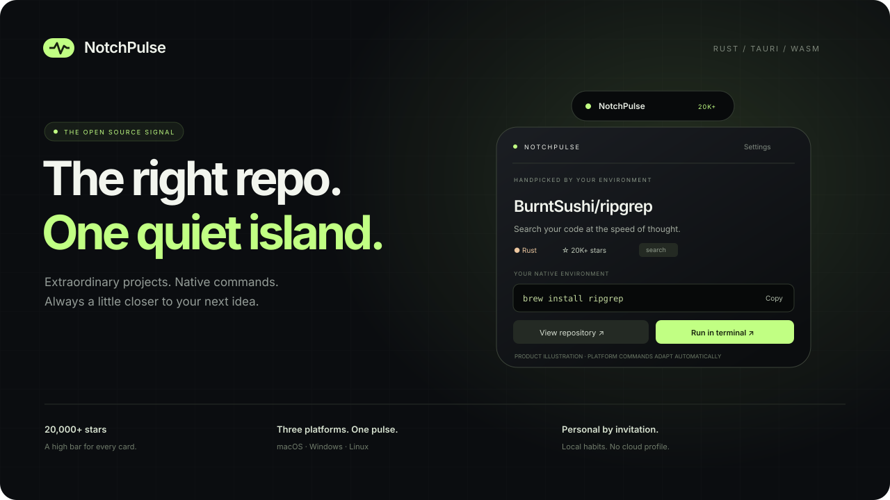

<div align="center">



**A quiet signal for extraordinary open source.**

Rust end to end · Tauri 2 · WebAssembly · Your native terminal


[Experience](#a-little-island-a-better-signal) · [Build](#run-it-locally) · [Architecture](docs/ARCHITECTURE.md) · [Release](docs/RELEASING.md)

</div>

## A little island. A better signal.

NotchPulse sits at the top center of your display. Hover and it unfolds into a compact stream of remarkable GitHub projects. Copy a command made for your machine, open the repository, or review an action and send it straight to a visible terminal.

No browser tabs to babysit. No cloud profile. No JavaScript application framework.

| A deliberate detail | What it does |
| :--- | :--- |
| **A high bar** | Every card comes from a non-fork, non-archived GitHub repository with at least **20,000 stars**. |
| **Your environment, understood** | PowerShell and winget on Windows; zsh/Homebrew on macOS; detected shell and apt, pacman, dnf, or Cargo on Linux. |
| **A small, physical feeling** | An analytical damped spring drives compositor transforms. Animation frames stop at rest. |
| **Quiet by default** | Roughly 15-minute refreshes, conditional requests, exponential backoff, pause, and a bounded disk cache. |
| **Personal when invited** | Opt into scanning manifest names in a project folder. Local language counts guide GitHub queries. |
| **Built to sit naturally** | Frameless, transparent, always on top; primary-display placement, per-display scaling, notch inset on macOS, and manual camera calibration. |

> **Engineering status:** source implementation, not a measured production release. Rust builds and native desktop testing have not been run in the authoring environment, which had no Rust toolchain or compiler-download access. The included CI performs those builds. No installer binaries, latency measurements, or memory benchmarks are represented as already verified.

## Run it locally

Install [Rust stable](https://rustup.rs/) and the [Tauri native prerequisites](https://v2.tauri.app/start/prerequisites/) for your OS. Windows needs the MSVC C++ build tools and WebView2; Linux needs WebKitGTK **4.1**, GTK3 and an app-indicator implementation; macOS needs Xcode command-line tools.

```sh
git clone https://github.com/rvnsre/NotchPulse.git NotchPulse
cd NotchPulse
rustup target add wasm32-unknown-unknown
cargo install trunk --version 0.21.14 --locked
cargo install tauri-cli --version 2.8.4 --locked
cargo tauri dev
```

All interface behavior is written in Rust and compiled to WASM with `wasm-bindgen`. Trunk generates the small JavaScript loader and bridge bindings required by the browser runtime. HTML and CSS provide the document and styling; no handwritten JavaScript is needed.

No GitHub token is required for the public feed. To increase the API rate limit, optionally set `NOTCHPULSE_GITHUB_TOKEN` in the environment **before launching the app**. Tokens are kept out of the UI, settings, cache, and repository. GitHub may apply secondary rate limits even with authentication.

## Find your flow

1. Hover over the compact pill or focus it with the keyboard to expand it.
2. Use **‹ / ›**, or the arrow keys, to browse the feed.
3. **Copy** copies the displayed command. **Run in terminal** opens a review; confirm to launch the visible terminal.
4. Open **Settings** to choose a display, shift the camera anchor, add a top inset, reduce motion, or enable personalization.
5. Press **Escape** to collapse. The system tray provides Show, Refresh, and Quit.

The OS window shrinks to **228 × 60 logical points** after collapse, so the invisible area beneath it does not intercept desktop clicks. The expanded panel lives in a **460 × 380** window. Small transparent margins remain inside those rectangles.

### Commands that belong on your machine

| Platform | Environment | Example for `sharkdp/bat` |
| :--- | :--- | :--- |
| Windows | PowerShell / winget | `winget install --exact --id sharkdp.bat` |
| macOS | Native terminal / Homebrew | `brew install bat` |
| Debian / Ubuntu | Detected shell / apt | `sudo apt install bat` |
| Arch | Detected shell / pacman | `sudo pacman -S bat` |
| Fedora family | Detected shell / dnf | `sudo dnf install bat` |
| Cargo fallback | Rust toolchain | `cargo install --locked bat` |

Installation recipes are a small, reviewed mapping of upstream repository identities. Other cards offer `git clone -- https://github.com/owner/repo.git`. NotchPulse never treats a README or repository description as executable code. A command may require network access, a package manager, or a password prompt; NotchPulse does not dismiss those prompts. Git clones run from your home directory and fail safely if their destination already exists.

Windows prefers Windows Terminal and falls back to a PowerShell console. macOS activates Terminal.app in its native architecture. Linux tries GNOME Terminal, Konsole, Xfce Terminal, xterm, and Kitty. Linux execution uses bash or zsh as a predictable launcher, including when your interactive shell is fish or Nushell. If no supported terminal is installed, **Copy** remains available.

## Privacy, with a clear boundary

Personalization is **off by default**. When enabled, NotchPulse checks known manifest filenames in your selected folder and up to 128 immediate child directories. It does not inspect source, traverse symlinks, monitor keystrokes, inspect editor processes, or read shell history. `package.json` is treated as a TypeScript ecosystem signal, not proof that every project uses TypeScript.

Only the highest-ranked language name is added to a public GitHub search. Paths, file contents, and language counts stay local. There is no telemetry endpoint. The token, if supplied, goes only to `api.github.com`. The first offline launch shows an honest empty state; subsequent offline launches show the last saved feed.

Preferences and the feed cache live under Tauri's per-user application data directory for `dev.notchpulse.desktop`. Corrupt or oversized JSON files are ignored. Settings are written through a same-volume replacement. Disable personalization to clear its active language profile; the configured path remains in your local preferences until you remove it.

## Performance without invented numbers

**Sub-30 MB is a native-process budget to investigate, not a guaranteed total footprint.** Tauri uses WebView2, WKWebView, or WebKitGTK, whose renderer and shared runtime memory are OS-dependent. A Rust backend cannot guarantee that the entire process tree consumes under 30 MB. “Zero lag” is an interaction goal, not a physical guarantee.

The implementation limits the feed to 12 cards, caps API bodies at 1 MiB, uses the system webview, avoids remote images and font requests, and schedules no permanent frontend render loop. Network requests normally happen every 15–16 minutes; manual refreshes are throttled to at least 60 seconds. Retries back off to one hour, while GitHub reset and retry headers are respected up to 24 hours. See [the measurement protocol](docs/PERFORMANCE.md) before publishing numerical claims.

## Displays and platform boundaries

- **macOS 12+:** reads the primary screen's native notch safe-area inset on the AppKit main thread. Other displays use top-center placement plus your calibration.
- **Windows 10/11 and Linux X11:** use monitor origin, physical size, and target scale factor, including negative desktop coordinates. Webcam sensors generally do not expose a portable on-screen position. Calibrate an off-center webcam in Settings.
- **Wayland:** compositors can prohibit arbitrary window positioning, always-on-top, or cross-workspace placement. Use an X11 session or a compositor window rule. The app reports the limitation; it cannot override compositor policy.
- The primary display is followed by default. Selecting a display stores its name and origin; if it is missing, placement falls back to the primary display. OS move and scale-change events trigger re-anchoring. Re-save display settings after a primary-display change that does not generate a native move event.
- Linux RPM builds use an Ubuntu 22.04 **glibc 2.35** baseline and require WebKitGTK 4.1. This is **not a RHEL 8/9 compatibility claim**. Enterprise rollout needs validation of the target distribution's ABI, WebKit and app-indicator packages.

## Build and ship

```sh
cargo test -p pulse-core
trunk build --release
cargo test -p notchpulse

# On Windows
cargo tauri build --bundles nsis
# On macOS, after installing both Darwin Rust targets
cargo tauri build --target universal-apple-darwin --bundles dmg
# On Linux with RPM prerequisites
cargo tauri build --bundles rpm
```

Push a matching version tag, such as `v0.1.0`, to start the packaging matrix. It produces a universal macOS DMG, a Windows NSIS installer **and separate standalone EXE**, and a Linux x64 RPM. Each platform includes SHA-256 checksums. Tagged builds create a **draft** GitHub release after every platform succeeds; workflow dispatch produces downloadable Actions artifacts without creating a release.

The standalone EXE needs WebView2 installed on the target machine. The NSIS installer can bootstrap that runtime. Native platform jobs are used instead of pretending that one Linux host can package every OS. macOS builds cross-compile both Darwin architectures and combine them into one universal application.

Signing requires your certificates. macOS secrets are wired into the workflow; Windows Authenticode signing must be configured for your signing provider before public distribution. Unsigned artifacts are test builds. See [release operations](docs/RELEASING.md) for the exact boundaries and checklist.

The initial source delivery does not contain a resolved `Cargo.lock`: dependency resolution was unavailable during authoring. The release workflow prepares a **single shared lockfile**, passes it to every platform, and uploads it. For repeatable releases across time, resolve, review, and commit `Cargo.lock` before your first public tag. Workflows honor the committed graph without re-resolution.

## The repository

| Path | Responsibility |
| :--- | :--- |
| `crates/pulse-core` | Shared wire models, strict feed eligibility, ranking, safe recipes, geometry, spring physics and unit tests |
| `crates/pulse-ui` | Rust/WASM DOM interface, IPC, input, animation, settings, and accessibility |
| `src-tauri/src` | Native lifecycle, tray, GitHub client, persistence, platform detection, terminal launch, and display placement |
| `.github/workflows` | Verification, native packaging, draft releases, and scheduled dependency auditing |
| `scripts` | Release version checks, artifact staging, and source validation |
| `docs` | Architecture, performance protocol, release guide, and manual acceptance matrix |

Made for developers who prefer a good signal to another dashboard.

MIT licensed. Not affiliated with GitHub or Apple. Dynamic Island is an Apple product concept; NotchPulse is an independent desktop utility.
