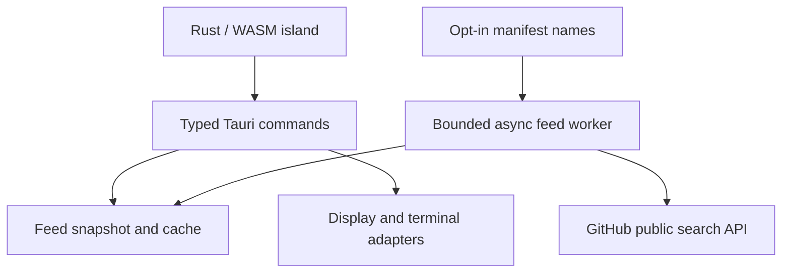

# Architecture

The webview renders a local Rust/WASM program. The native Rust process owns the network, filesystem, clipboard, URL opening, monitor placement and subprocess launch. Only repository IDs and typed preference data cross IPC. External descriptions are escaped before HTML rendering.



## Native lifecycle

Tauri initializes one hidden window, loads validated preferences and a bounded cache, shrinks the native window, computes its anchor, installs a tray menu, then shows it. The single-instance plugin activates the existing window instead of creating a duplicate. A single Tokio worker owns feed requests and wakes on a timer or explicit notification. The last feed remains readable while network requests are pending.

Settings updates are serialized. Manifest scanning runs on a blocking worker. The native window and AppKit calls run on the main thread; UI resize awaits completion before beginning the opening transform. Tray callbacks never run shell commands. Terminal launcher children are reaped on dedicated short-lived threads.

## Feed

The query is `stars:>=20000 archived:false fork:false`, optionally followed by one allowlisted language. GitHub returns up to 30 recently updated projects. Local ranking prefers a matching language, then star count. Results are filtered again, deduplicated by ID, and capped at 12. “Curated” means this deterministic algorithm, not an LLM or a code-quality/security audit. A star threshold is not a security guarantee.

The worker never follows HTTP redirects and uses rustls with HTTPS-only transport. Search responses are streamed into at most 1 MiB. ETags are bound to the exact query. Error status, rate-limit reset, Retry-After and network failure select a bounded retry window. Only successfully parsed responses or 304s update the saved timestamp. UI status distinguishes live, cached, offline and failed requests.

Preferences may change while a request is in flight. Each request carries a profile revision; a response for an older revision is discarded before it can replace the feed or disk cache. A monotonic scheduler honors cooldowns and retains a manual refresh until it is allowed. Pause stops subsequent requests and automatic expansion; an already-started request may complete. Profile changes and server cooldowns do not guarantee an immediate new request.

## Geometry

For a monitor with physical origin `(mx, my)`, physical dimensions `(mw, mh)`, scale `s`, logical window size `(w, h)`, camera calibration `dx`, and logical top inset `t`:

```text
x = clamp(mx + (mw - w*s)/2 + dx*s, mx, mx + mw - min(w*s, mw))
y = clamp(my + t*s, my, my + mh - min(h*s, mh))
```

`anchor()` uses dimensions capped to the monitor before centering and clipping, and preserves negative origins. It rounds once at the final physical-position boundary. The current window scale converts measured native size back to logical points; the destination monitor scale converts logical points into its physical coordinates. A scale-change event re-anchors after the OS applies its own DPI transition.

On macOS, the primary `NSScreen.safeAreaInsets.top` is added to the user inset. Primary notch geometry is obtained only from native APIs, never inferred from a model name. External webcam placement is calibrated manually. A display preference includes its name and origin; it is intentionally not claimed to be a persistent hardware ID.

## Motion and input

`pulse-core::spring` implements the closed-form underdamped oscillator with angular frequency 22 and damping ratio 0.82. WASM requests a frame only during motion; the spring preserves velocity when reversed. Background frame gaps are clamped. The surface uses transform scaling; content fades independently so text does not stretch. Reduced-motion preferences skip the spring. One application-level set of event listeners survives renders.

Expanding first enlarges the native rectangle; collapsing first animates, then shrinks it. The expanded state exposes its content to accessibility APIs; collapsed content is inert. Keyboard arrows navigate, Escape collapses, buttons have focus styling, and a live region announces updates. A focused control, settings form, or review prevents automatic collapse. Command review freezes the frontend snapshot so incoming cards cannot silently change the reviewed identity.

## Execution boundary

The UI submits a repository ID, explicit confirmation, and the command it reviewed. The backend verifies that the ID is still eligible, regenerates the recipe, requires an exact match with the reviewed command, and rate-limits launches using a monotonic clock. The submitted text is only compared; it is never executed. Clipboard and URL operations use similarly validated IDs. The native launcher resolves an executable path itself and applies platform quoting to reviewed argv.

Known recipes are selected by exact upstream repository names, never README instructions. Unknown repositories can only produce a validated HTTPS Git clone. Shell quoting is platform-specific. PowerShell uses a UTF-16LE encoded payload with no execution-policy bypass. macOS transports a reviewed command through a base64-only AppleScript argument to Terminal.app. Linux passes a command as a single argument to a known POSIX shell in a visible terminal. No command is run merely because a card arrives.

## Deliberate limits

This version does not inspect editor focus, run a language model, measure code quality, download project icons, track releases individually, auto-start at login, install background services, or operate a camera. Notifications are changes in the curated repository list, not guaranteed real-time GitHub events. It needs actual desktop validation before a production release; see TESTING.md.
